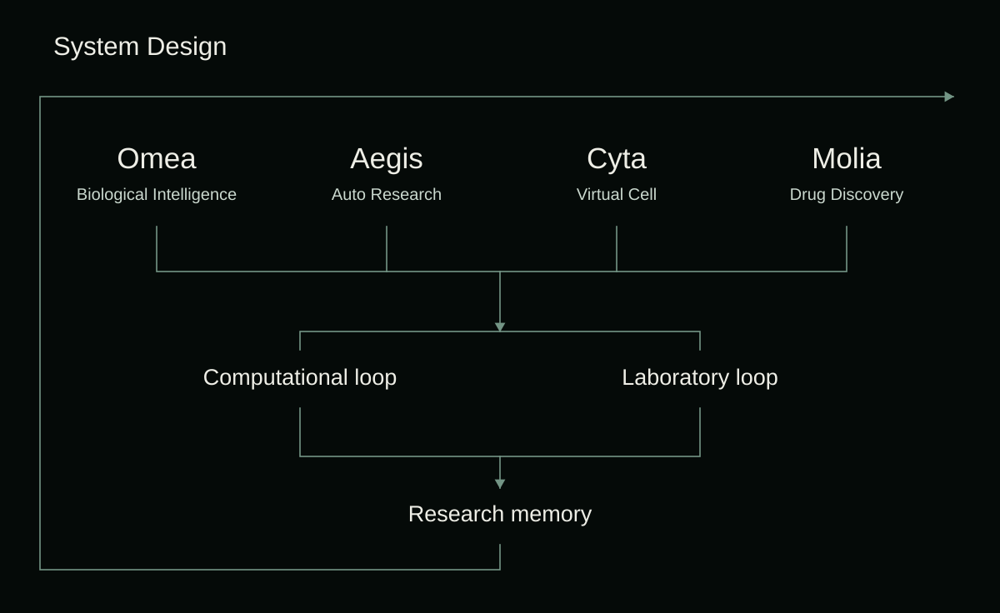

# Products

| Product | Focus | Overview |
| --- | --- | --- |
| [**Omea**](omea/README.md) | Biological Intelligence | Biological intelligence for life-science research. |
| [**Aegis**](aegis/README.md) | Auto Research | Scientific research workflows. |
| [**Cyta**](cyta/README.md) | Virtual Cell | Cellular perturbation-response prediction. |
| [**Molia**](molia/README.md) | Drug Discovery | Molecular generation and computational candidate evaluation. |

## System Design

Computational loop, Laboratory loop and Research memory define the shared system design.

## Access

These pages provide product introductions. Core product implementations remain private.

[Website](https://www.advaita.xyz/) · [Aegis](https://aegis.advaita.xyz/) · [Contact](mailto:dev@advaita.xyz)
