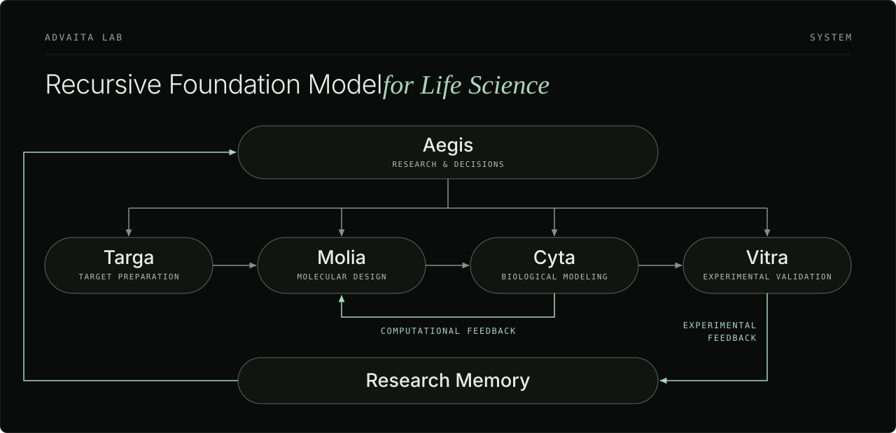

# Advaita Lab

### Recursive Foundation Model for Life Science

We are developing scientist-level intelligence through research systems designed to improve models, methods and decisions through computational and experimental feedback.

[System](#system) · [Products](#products) · [Applications](#applications) · [Research & Methods](#research--methods) · [Team Research](#team-research) · [Repository Map](#repository-map)

---

## Mission

**Regenerate life.** 
**Make longevity possible.** 
**For everyone.**

### Vision

We envision an enduring institution that develops scientist-level intelligence, enabling every pipeline to compound in value, whoever owns it and wherever it runs.

### Values

Create without waiting 
Verify without ambiguity 
Recurse without stopping

## System

**Better science builds better models. Better models advance the next discovery.**

Our architecture connects research, design, biological modeling and experimental validation. Aegis supports research and decisions across Targa, Molia, Cyta and Vitra.

The system is designed around two feedback paths: Cyta to Molia for computational feedback, and Vitra through Research Memory to Aegis for experimental feedback. Each cycle is intended to improve models, methods and subsequent research decisions.

<picture>
  <source media="(prefers-color-scheme: dark)" srcset="./assets/system-dark.svg">
  <source media="(prefers-color-scheme: light)" srcset="./assets/system-light.svg">
  
</picture>

## Products

[Aegis](#aegis) · [Targa](#targa) · [Molia](#molia) · [Cyta](#cyta) · [Vitra](#vitra)

### Aegis

*Research & Decisions*

Investigate scientific questions across literature, databases, patents and clinical-trial records. Organize findings and cited sources into research reports.

> Research question → Source retrieval → Cited report

### Targa

*Target Preparation*

Organize target identity, receptor preparation and binding-pocket definition. Preserve the structures, settings and source records used by downstream calculations.

> Target → Prepared receptor → Defined pocket

### Molia

*Molecular Design*

Screen compound libraries or generate candidates under defined structural constraints. Integrated workflows include PocketXMol and AutoFragDiff, with structure checks, scoring and saved molecular outputs.

> Library or design constraints → Candidates → Quality checks → Scores and records

[Molecular-design methods: Omea](https://github.com/AdvaitaLabs/Omea)

### Cyta

*Biological Modeling*

Develop task-specific workflows for target interactions and biological responses. The framework covers exposure, binding and cell or tissue response; current work focuses on binding evaluation and early cell-response workflow tests.

> Molecule and biological context → Selected model → Computational evaluation

### Vitra

*Experimental Validation*

Design the handoff from computational candidates to laboratory studies. Define experimental endpoints, controls, quality checks and the return of reviewed results to Research Memory for subsequent research and design decisions.

> Candidates → Experimental design → Result review → Research Memory

## Applications

Molecular discovery and cellular modeling are our initial applications.

### Small-Molecule Discovery

Targa supplies receptor and pocket inputs. Molia produces candidates through library screening or constrained generation. Cyta provides computational evaluation for selection and redesign in Molia. Vitra defines laboratory studies and how reviewed results return through Research Memory to Aegis.

Aegis supports research and decisions throughout. Cell-response modeling and organoid studies are optional extensions in the workflow design.

### Cellular Modeling

Cyta develops task-specific models of cellular response. Current research includes CRISPRi perturbation-response prediction, documented in [Cyta Research](#cyta-research).

## Research & Methods

### Omea

Omea provides molecular-design methods and benchmarks within Molia’s research. It evaluates single-site R-group replacement under shared structural and computational-scoring criteria.

Public native-reconstruction guidance results: 12.00% → 16.50% qualifying attempts on 30 development cases, with 3,000 attempts per configuration. Qualification requires structural checks and improvement in both Vina and GNINA scores.

[Repository](https://github.com/AdvaitaLabs/Omea) · [Guidance method and results](https://github.com/AdvaitaLabs/Omea/blob/main/docs/guidance.md) · [Source-validation record](https://github.com/AdvaitaLabs/Omea/blob/main/docs/guidance_validation.json)

### AegeanBench

Evaluate multi-agent consensus and collaboration through defined tasks and metrics.

[Repository](https://github.com/AdvaitaLabs/Aegeanbench)

### Cyta Research

CRISPRi perturbation-response research: use a target gene, control-cell profiles and reference perturbations to predict differential expression and single-cell expression outputs.

This research track is documented separately from Cyta’s simulation framework.

## Team Research

Our team’s prior research spans [ICML](https://proceedings.mlr.press/v267/wan25c.html), [NSDI](https://www.usenix.org/conference/nsdi26/presentation/wei), [Nature Computational Science](https://www.nature.com/articles/s43588-025-00886-7) and [Nature Nanotechnology](https://www.nature.com/articles/s41565-021-00870-y), with recognition including an [NSDI Outstanding Paper Award](https://www.usenix.org/conference/nsdi26/presentation/wei).

## Repository Map

Published research and upstream components, organized by workflow.

| Workflow | Role | Repositories |
|:--|:--|:--|
| **Aegis** — Research & Decisions | Research evaluation | [AegeanBench](https://github.com/AdvaitaLabs/Aegeanbench) |
| **Targa** — Target Preparation | Upstream models | [alphafold3](https://github.com/AdvaitaLabs/alphafold3) · [boltz](https://github.com/AdvaitaLabs/boltz) · [esm](https://github.com/AdvaitaLabs/esm) |
| **Molia** — Library Screening | Upstream tools | [Uni-Dock](https://github.com/AdvaitaLabs/Uni-Dock) · [gnina](https://github.com/AdvaitaLabs/gnina) · [Meeko](https://github.com/AdvaitaLabs/Meeko) · [openbabel](https://github.com/AdvaitaLabs/openbabel) |
| **Molia** — Molecular Design | Methods & benchmarks | [Omea](https://github.com/AdvaitaLabs/Omea) |
| | Upstream dependencies | [rdkit](https://github.com/AdvaitaLabs/rdkit) · [pytorch](https://github.com/AdvaitaLabs/pytorch) |
| **Cyta** — Biological Modeling | Upstream scoring components | [gnina](https://github.com/AdvaitaLabs/gnina) · [boltz](https://github.com/AdvaitaLabs/boltz) · [LightGBM](https://github.com/AdvaitaLabs/LightGBM) |
| | Upstream cell-response models | [state](https://github.com/AdvaitaLabs/state) · [chemCPA](https://github.com/AdvaitaLabs/chemCPA) |
| **Vitra** — Experimental Validation | Experimental workflow design | [Vitra](#vitra) |

## Sources & Attribution

Upstream models, datasets and software retain their original attribution. Repository documentation identifies Advaita’s implementation and the scope of each release.

## Contact

[Advaita website](https://www.advaita.xyz/) · [hello@advaita.xyz](mailto:hello@advaita.xyz)
